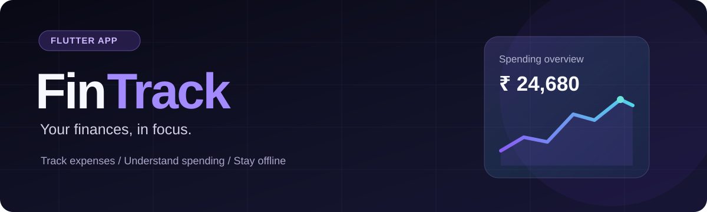
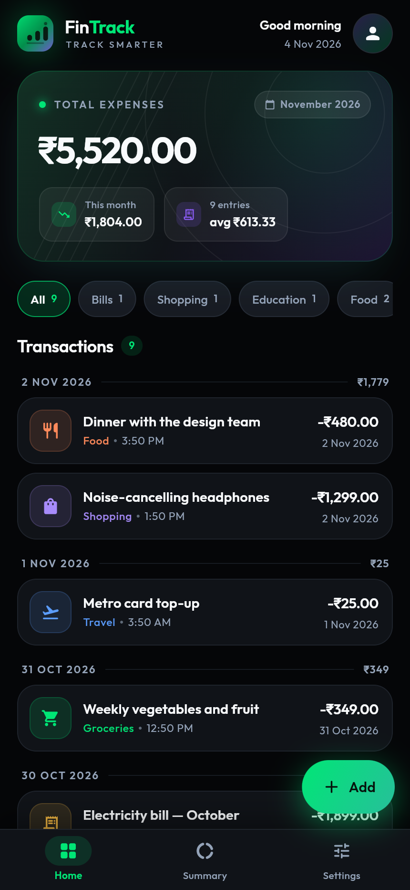
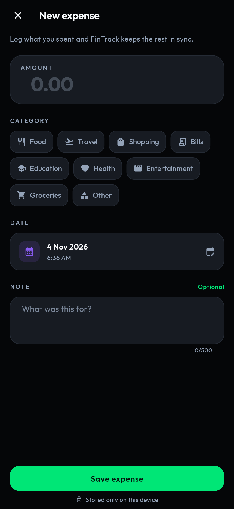
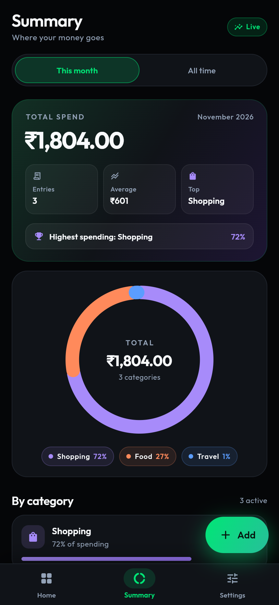
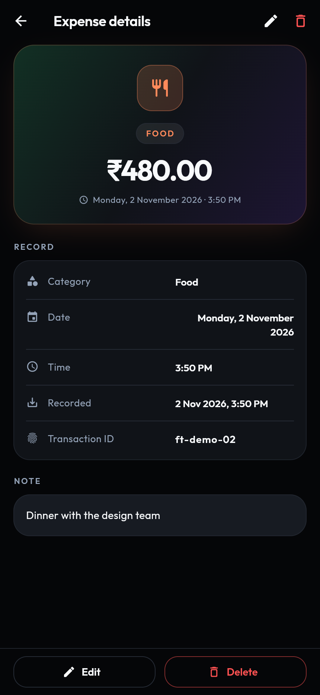
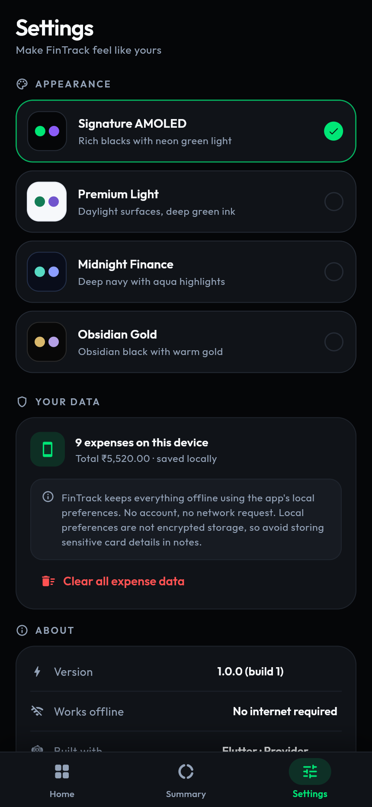
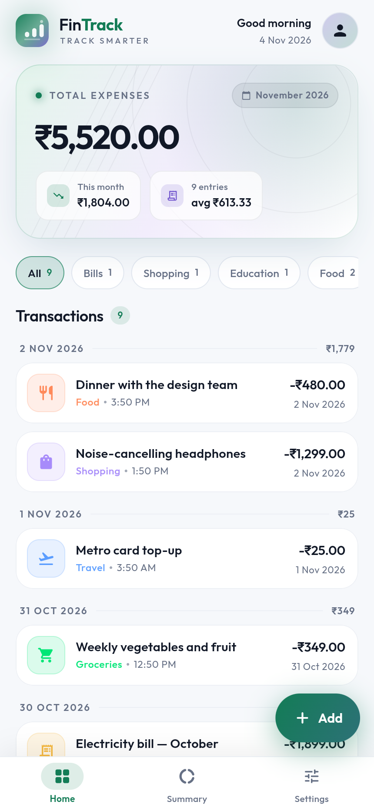

<div align="center">



# FinTrack · Premium Expense Tracker

**A thoughtfully designed, offline-first personal expense tracker built with Flutter.**

<p>
  
  
  
  
</p>

[App preview](#app-preview) · [Features](#features) · [Run locally](#get-started) · [Architecture](#architecture) · [Privacy](#privacy-and-data)

</div>

---

## What is FinTrack?

FinTrack helps people **capture daily spending, understand where their money goes, and review category-wise trends**, without requiring an account or online sync. Its UI emphasizes readable summaries, polished motion, and adaptable light and AMOLED-inspired dark themes.

Unlike a banking app, FinTrack is a **local expense journal**. It does not connect to banks or process payments.

## App preview

*Screenshots below are included in this repository and show the app's own UI.*

<table>
<tr>
<td width="33%" align="center"><br/><b>Dashboard · dark</b></td>
<td width="33%" align="center"><br/><b>Add expense</b></td>
<td width="33%" align="center"><br/><b>Spending summary</b></td>
</tr>
<tr>
<td align="center"><br/><b>Expense detail</b></td>
<td align="center"><br/><b>Theme settings</b></td>
<td align="center"><br/><b>Dashboard · light</b></td>
</tr>
</table>

More screenshots: [Light settings](docs/screenshots/06-settings-light.png) · [Storage error state](docs/screenshots/08-error-state.png) · [Empty state](docs/screenshots/09-empty-state.png)

## Features

| Feature | How it works |
| --- | --- |
| **Expense management** | Add entries with amount, category, date and optional note; view and edit expense details |
| **Overview dashboard** | Review expenses and current totals at a glance |
| **Spending insights** | Explore category breakdowns, totals and a chart-driven summary |
| **Adaptive visual themes** | Switch between available theme presets, including AMOLED-style dark and light variants |
| **Local persistence** | Save JSON-serialized expense entries using `shared_preferences` |
| **Responsive state** | Provider-based updates keep screens consistent after edits |
| **Helpful states** | Includes loading, empty, storage-error and retry experiences |
| **Precision** | Amounts are stored as integer minor currency units (paise) to reduce rounding errors |

## Technology

| Layer | Tools |
| --- | --- |
| App framework | Flutter + Dart |
| UI components | Material UI, Google Fonts, custom themes and animations |
| State management | `provider` |
| Local persistence | `shared_preferences` + JSON |
| Formatting | `intl` |
| Charts | `fl_chart` |
| Tests | `flutter_test` and existing model/provider/widget test files |

## Get started

### Requirements

- Flutter SDK compatible with the Dart constraint in [pubspec.yaml](pubspec.yaml)
- Android Studio / Android emulator, Chrome, or another supported Flutter device
- Flutter and Dart installed and available on your PATH

```bash
git clone https://github.com/svsramakrishnanaidu-rgb/fin-tracker.git
cd fin-tracker
flutter pub get
flutter run
```

To preview locally in a browser (Flutter web development):

```bash
flutter run -d chrome
```

**Note:** A local browser preview is not the same as a publicly deployed website. No verified public FinTrack demo URL is currently documented in this repository.

### Quality checks

```bash
flutter analyze
flutter test
flutter build web
```

These are the available local commands, **not claims that a CI run has passed**.

## Architecture

```text
lib/
  main.dart         App bootstrapping and provider registration
  models/           Expense and category data models
  providers/        Expense + theme state
  services/         Local storage abstraction and persistence
  screens/          Home, summary, settings, add, and detail views
  widgets/          Reusable cards, charts, selectors, states
  theme/            Brand themes and design tokens
  utils/            Helpers
test/               Model, provider and widget tests
docs/screenshots/   UI screenshots
web/                Flutter web shell and icons
```

### Data flow

```text
User adds or edits an expense
            ↓
ExpenseProvider (ChangeNotifier)
            ↓
SharedPreferencesExpenseStorageService
            ↓
JSON saved to the current device
            ↓
Dashboard + summary refresh
```

## Privacy and data

FinTrack works without an app account or a hosted database. Expense entries remain in the local app storage used by the current installation. The storage implementation uses `shared_preferences`, which **is not encrypted storage**; don't treat it as protection against device compromise. Clearing app or browser storage, uninstalling, or changing devices may remove records. There is **no bank integration, automatic backup, or cross-device synchronization** in this version.

## Project links

- **Source repository:** [GitHub · fin-tracker](https://github.com/svsramakrishnanaidu-rgb/fin-tracker)
- **See the app:** [Screenshot gallery](#app-preview)
- **Published website:** Not currently documented. The app can be run locally with Flutter; a future hosted demo should be linked only after it has been deployed and verified.
- **Creator:** [Sandu Venkata Siva Ramakrishna](https://github.com/svsramakrishnanaidu-rgb)

## Next improvements

- [ ] Publish a verified browser demo or distributable release
- [ ] Add CI for `flutter analyze` and `flutter test`
- [ ] Add optional export/import or backup before relying on long-term storage
- [ ] Expand accessibility and platform tests

<div align="center"><sub>Built with a focus on everyday usability, visual craft, and transparent local-first data handling.</sub></div>
